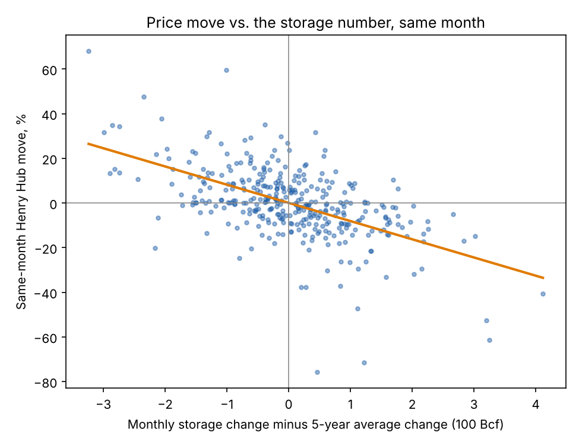
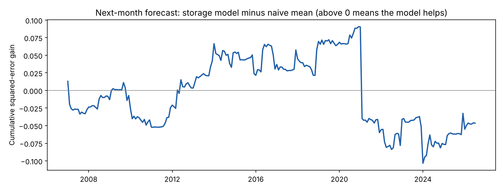
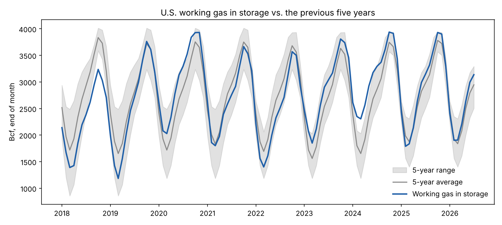
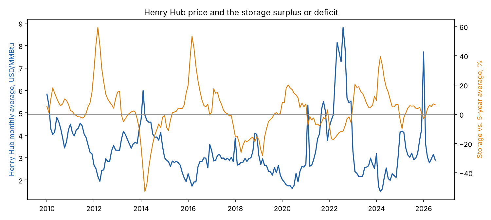

# natgas-storage-model

How much of a Henry Hub price move can you read off the EIA storage numbers? I compare
U.S. working gas in storage with the previous five years, then check two things:

1. Does the storage news explain the price move **in the same month**?
2. Does it help forecast the price move **in the next month**, out of sample?

It is a small study, not a trading system. I wrote it to understand how a gas desk reads
the storage report against the seasonal norm.

## Data

Three tables from the EIA Natural Gas Monthly (https://www.eia.gov/naturalgas/monthly/,
"XLS" links in the table of contents), kept in `data/raw/`:

| File | Table | Used for |
|---|---|---|
| `ngm08_storage.xlsx` | 8, underground storage, all operators | end-of-month working gas, 1976 to Jul 2026 |
| `ngm03_prices.xlsx` | 3, national average prices | Henry Hub monthly average spot price, Jan 1997 to Aug 2026 |
| `ngm01_supply_disposition.xlsx` | 1, supply and disposition | not used in the model yet (see below) |

## Method

- For each month, take the same calendar month in the five previous years and compute the average, min and max of the inventory and the average monthly change. The current year is never in its own window.
- Two features:
  - `change_dev`: monthly change in storage minus the five-year average change for that month (per 100 Bcf). Positive means a bigger injection or a smaller withdrawal than normal, which is bearish.
  - `surplus_pct`: inventory above or below the five-year average, in %.
- Same-month fit: OLS of the log change in the monthly average price on both features, Newey-West standard errors (3 lags).
- Next-month fit: the same regression with the log price change of month t+1 as target and features dated t. Storage at the end of month t is already public from the weekly reports before most of month t+1's prices are set.
- Out of sample: expanding-window walk-forward. Refit every month on past data only, predict the next month, compare squared errors with a naive benchmark (the mean of past price moves).

## Findings

Sample: 1997-01 to 2026-07, 355 months. Full output in `outputs/results.txt`.

**Same month, the storage number matters a lot.**
A monthly injection 100 Bcf above the five-year norm goes with a Henry Hub move about 8% lower in that month
(coefficient -0.082, t = -9.7). The two features explain 31% of the variance in monthly price changes. The inventory
level against the five-year average adds nothing once the change is in the model (p = 0.60).
This is an association: price and storage both react to the same weather, so I do not read it as storage causing the move.



**Next month, there is nothing to trade.**
In sample the next-month regression has an R-squared of 3%. Out of sample the model does not beat the naive mean:

| Walk-forward, next month | Months | OOS R-squared vs. mean | Sign hit rate |
|---|---|---|---|
| Full sample (min 120 months of training) | 235 | -0.7% | 54.0% |
| 2010 onward (min 84 months) | 115 | -1.3% | 52.2% |
| Full sample without Jan-Feb 2021 (Winter Storm Uri) | 233 | +1.6% | 54.5% |

The cumulative chart shows the model ahead of the benchmark from 2012 to 2020 and then giving it all back in one
month (February 2021, when the price spiked about 70% and reversed). Even without those two months the gain is
under 2% of the variance, which would not survive costs.



The sign on `surplus_pct` in the next-month regression is positive (a storage surplus is followed by a slightly higher price).
I read that as mean reversion after the price has already fallen, not as a bullish signal.

My conclusion: at a monthly frequency the market prices the storage news within the month. The lag I was
looking for is not there, so any edge would have to come from the weekly report timing, from weather, or from the gap to
analyst expectations.




## What it leaves out

- Weekly data. The EIA report comes out every Thursday and the real reaction happens within days, which monthly averages blur. A weekly version with Friday-to-Friday prices is the natural next step.
- Weather (heating and cooling degree days), which drives most of the injection surprise.
- Market expectations. The gap to the five-year average stands in for the surprise. A survey or consensus estimate is the proper benchmark.
- Production, LNG exports and power burn. Table 1 has them, but its figures for month t are published after month t+1 ends, so using them to forecast would look ahead. They would fit a same-month balance model.
- Monthly averages smooth the price, which adds some autocorrelation to price changes. The standard errors correct for it, the point estimates do not.
- Monthly storage is the all-operators survey, which differs slightly from the weekly estimate traders watch.
- Spot prices only, linear model.

## Run it

```
pip install -r requirements.txt
python scripts/run.py
pytest
```

## Layout

```
data/raw/               the three EIA tables (xlsx)
src/natgas/data.py      load the tables
src/natgas/storage.py   five-year comparison features
src/natgas/model.py     dataset, OLS fits, walk-forward
src/natgas/plots.py     charts
scripts/run.py          end-to-end run, writes outputs/
tests/                  unit tests on small made-up series
```

The tests use made-up series where the right answer is known (for example, a series built from the
year and month number so the five-year average can be computed by hand). They check the code, not the market.
